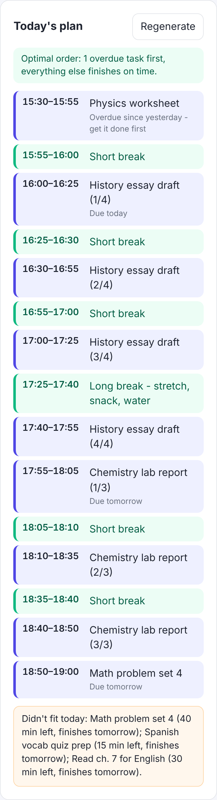
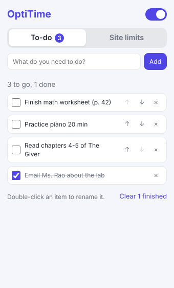

# OptiTime

[](https://github.com/aadijewargi/optitime/actions/workflows/test.yml)
[](LICENSE)

A web app that helps teenagers beat procrastination with structured daily schedules, a task manager, and interactive focus timers.

The daily plan is built by an **optimizer**, not a fixed sort. It finds the task order with the least priority-weighted lateness. For up to 18 tasks it is provably optimal (dynamic programming over subsets); for more it uses a fast heuristic. It also explains every decision it makes.

<p align="center">
  
</p>

## Chrome extension: site blocker and to-do list

OptiTime includes a Chrome extension (in `extension/`) that blocks distracting websites once your daily time limit is used up, and keeps a quick to-do list one click away in the toolbar.

<p align="center">
  
</p>

- **Per-site daily limits** – add a site (e.g. `youtube.com`) and a limit in minutes. A limit of `0` blocks the site entirely.
- **Real blocking** – when time is up, the browser itself redirects the site (and its subdomains) to a "Time's up" page, using Chrome's `declarativeNetRequest` API. Tabs that are already open on the site are moved to the block page too.
- **Fair timing** – time only counts while Chrome is the focused window, the site is the active tab, and you aren't idle.
- **Resets at midnight** – usage is tracked per day, in your local time.
- **On/off switch** and a toolbar badge showing how many sites are currently blocked.
- **To-do list** – the popup opens on a To-do tab. Add items, tick them off, rename one by double-clicking it, reorder with the ↑/↓ buttons, and clear finished items in one click. The tab shows how many are left, and the popup remembers which tab you used last.
- **Something better to do** – when a site is blocked, the "Time's up" page lists the next five things on your to-do list, and you can tick them off right there.
- All data stays in your browser (`chrome.storage.local`). Nothing is sent anywhere.

### Install it in Chrome

1. Open `chrome://extensions` in Chrome.
2. Turn on **Developer mode** (top right).
3. Click **Load unpacked** and choose the `extension` folder from this project.
4. Pin OptiTime from the puzzle-piece menu, click its icon, and add your first site.

The extension asks for access to all sites because Chrome requires that permission to redirect a page the extension doesn't own. It only acts on sites in your list.

> OptiTime is a self-discipline tool: anyone can turn it off or remove it from `chrome://extensions`.

## Features

- **Optimized schedule** – turns your task list into a realistic plan for the day. It looks ahead across days, so when there's too much to do, low-priority work slips instead of important work. Big tasks are split into focus-sized chunks, and short breaks are added automatically (a longer one every 4th block). Each task shows *why* it is where it is, and a "quick win" goes first whenever that makes nothing late. See [How the planner works](#how-the-planner-works).
- **Task management** – add tasks with an estimated time, due date, and priority; check them off; delete them. Time spent is tracked against each estimate.
- **Interactive daily timer** – Pomodoro-style focus/break timer tied to a selected task. Finished sessions are saved and update your progress automatically.
- **Progress stats** – minutes focused today, tasks completed today, and a day streak.
- **Persistent data** – stored server-side in a JSON file, keyed by an anonymous per-browser ID (no sign-up needed).

## How the planner works

### The problem

You have $n$ open tasks. Task $j$ still needs $p_j$ minutes, may have a due date, and has a priority weight $w_j$ (low = 1, medium = 2, high = 3). There is one of you, so the plan is an *order* of tasks. Big tasks are cut into focus blocks afterwards.

Every task goes on one **work clock** that runs across days and counts only focus minutes. With $c_0$ focus minutes left today and $c$ in a full day (both worked out from your day window, focus length and breaks), a task due $k$ days from now is due at

$$d_j = c_0 + k\,c, \qquad d_j = 0 \text{ if it is already overdue}, \qquad d_j = \infty \text{ if it has no due date.}$$

If an order finishes task $j$ at $C_j$ on that clock, the planner minimises, lexicographically:

$$
\underbrace{\sum_j w_j \max(0,\,C_j - d_j)}_{\text{weighted lateness}}
\;\;\succ\;\;
\underbrace{\sum_j w_j \max(0,\,C_j - s_j)}_{\text{keep a day of margin}}
\;\;\succ\;\;
\underbrace{\sum_j w_j\,C_j}_{\text{important and short first}}
$$

where $s_j = \max(0, d_j - c)$ is a soft target one day before the deadline. The first term decides who is late when there is too much to do. Being late costs priority × minutes, so missing a low-priority essay by an hour beats missing two high-priority tasks. The other two terms only break ties: when nothing has to be late, the plan aims to finish a day early, then does important and short work first.

The first term is the classic single-machine **total weighted tardiness** problem, $1\,||\,\sum w_jT_j$, which is strongly NP-hard (Lenstra, Rinnooy Kan & Brucker, 1977). All tasks are available now, so splitting a task into pieces can never help this objective. That is why the planner can choose an order of whole tasks and cut it into blocks afterwards.

### The algorithms

**Exact: dynamic programming over subsets** (`solveExact`, used for $n \le 18$). Whatever order a set of tasks $S$ is done in, the last one finishes at $p(S) = \sum_{j \in S} p_j$. So

$$\text{best}(S) = \min_{j \in S}\Big[\text{best}(S \setminus \{j\}) + \text{cost}_j\big(p(S)\big)\Big],$$

with $2^n$ states and $O(2^n n)$ time. Each of the three terms is a sum of per-task costs, so the lexicographic objective goes through the same recursion unchanged. For 18 tasks this takes about 45 ms.

**Heuristic: ATC + local search** (`solveHeuristic`, used above 18 tasks). It builds start orders with Apparent Tardiness Cost dispatching, which at time $t$ picks the task with the largest $\frac{w_j}{p_j}\exp\!\big(-\max(0, d_j - p_j - t)/(k\bar p)\big)$ for $k \in \{0.5, 1, 2, 4\}$, plus earliest-due-date and weighted-shortest-first orders. It improves each one with insertion moves (take a task out, put it back where it helps most) until nothing improves, and keeps the best result. It is not guaranteed to be optimal.

| | exact DP | heuristic |
|---|---|---|
| optimal | yes | not guaranteed (optimal in 97.5–100% of the benchmark instances below) |
| time | $O(2^n n)$ | $O(n^3)$ per local-search pass, at most 50 passes |
| memory | $O(2^n)$ | $O(n)$ |

**Then the day is laid out.** Today's window is cut into focus blocks and breaks. The ordered tasks are poured into the focus blocks, and a block that one task finishes early is filled by the next one instead of being wasted. Tasks that don't fit today report the day they are projected to finish.

### Worked example

From the tests: today has 50 focus minutes (15:00–16:00, 25/5), and tomorrow is a full day.

| task | minutes | priority | due |
|---|---:|---|---|
| big | 120 | low | today |
| a | 25 | high | tomorrow |
| b | 25 | high | tomorrow |

The old rule (earliest due date first) starts the big task and makes **all three** late. The optimizer accepts that the big low-priority task is late anyway and does `a` and `b` first, so **only one** task is late.

### Benchmark

Run it with `npm run bench`. The instances are random task lists (15–120 min, due within 0–3 days or undated, random priority) for a 15:00–18:00 day, and they are deliberately overloaded so that some lateness can't be avoided. "Rules" is OptiTime's previous due-date → priority → size order, scored with the same objective.

| tasks | instances | rules: mean weighted late min | heuristic | exact | rules worse than optimal | heuristic optimal | exact time (ms) | heuristic time (ms) |
|---:|---:|---:|---:|---:|---:|---:|---:|---:|
| 6 | 200 | 34 | 32 | 32 | 3.5% | 100.0% | 0.1 | 0.3 |
| 8 | 200 | 143 | 124 | 124 | 13.0% | 100.0% | 0.0 | 0.4 |
| 10 | 200 | 361 | 282 | 282 | 29.0% | 100.0% | 0.2 | 0.7 |
| 12 | 200 | 964 | 693 | 692 | 59.5% | 99.5% | 0.7 | 1.0 |
| 14 | 200 | 2006 | 1393 | 1392 | 79.0% | 98.0% | 2.7 | 1.2 |
| 16 | 40 | 2963 | 1845 | 1845 | 87.5% | 100.0% | 10.6 | 1.6 |
| 18 | 40 | 5431 | 3527 | 3526 | 97.5% | 97.5% | 46.2 | 2.3 |

Above the exact limit only the heuristic runs:

| tasks | rules: weighted late min | heuristic | heuristic time (ms) |
|---:|---:|---:|---:|
| 30 | 30865 | 20405 | 13 |
| 60 | 136090 | 79545 | 83 |
| 100 | 387840 | 245795 | 431 |

Timings are from one Linux machine with Node 22 and will vary.

### Correctness checks

`npm test` checks:

- the DP against **brute force over all permutations** on 300 random instances (1–7 tasks), for all three objective terms;
- known special cases: with no deadlines it reproduces Smith's WSPT rule, it finds a zero-lateness order whenever one exists, and with everything overdue it matches WSPT;
- the heuristic: it is never worse than EDD or WSPT, and it is optimal on at least 70% (with a mean gap under 5%) of random 10-task instances where it is compared to the DP;
- the schedule: blocks never overlap and never start in the past or end after the window, and no minutes of work are lost (scheduled + left over = remaining), checked over 50 randomized cases;
- edge cases: no tasks, a single task, identical tasks, an empty or inverted day window, and more than 18 tasks.

## Tech stack

- Node.js + Express (REST API)
- JSON-file data store (no database setup, no native dependencies)
- Vanilla HTML/CSS/JS frontend served by Express
- Node's built-in test runner

## Getting started

Requires Node.js 18 or newer.

```bash
npm install
npm start
```

Then open <http://localhost:3000>.

For auto-restart during development: `npm run dev`.

### Configuration

| Variable    | Default          | Description                  |
|-------------|------------------|------------------------------|
| `PORT`      | `3000`           | Port the server listens on   |
| `DATA_FILE` | `data/db.json`   | Where user data is stored    |

### Tests and benchmark

```bash
npm test
npm run bench
```

## API overview

All `/api` requests need an `x-user-id` header (the frontend generates one automatically).

| Method & path            | Purpose                                              |
|--------------------------|------------------------------------------------------|
| `GET /api/tasks`         | List tasks                                           |
| `POST /api/tasks`        | Create a task `{ title, estimateMinutes, dueDate?, priority? }` |
| `PATCH /api/tasks/:id`   | Update a task (including `done`)                     |
| `DELETE /api/tasks/:id`  | Delete a task                                        |
| `GET /api/schedule`      | Generate today's schedule (`?now=` is the browser's local time) |
| `GET/PUT /api/settings`  | Day window, focus and break lengths                  |
| `POST /api/sessions`     | Log a finished timer interval `{ minutes, type, taskId? }` |
| `GET /api/stats`         | Today's focus minutes, tasks done, streak            |

### What `GET /api/schedule` returns

```jsonc
{
  "blocks": [            // today, in order
    { "type": "focus", "taskId": "…", "title": "History essay draft", "part": "1/4",
      "start": "16:00", "end": "16:25", "minutes": 25, "reason": "Due today" },
    { "type": "break", "title": "Short break", "start": "16:25", "end": "16:30", "minutes": 5 }
  ],
  "unscheduled": [       // work that does not fit today
    { "taskId": "…", "title": "Math problem set 4", "minutesLeft": 40,
      "reason": "Partly scheduled - day window is full", "plannedFinish": "tomorrow", "late": false }
  ],
  "plan": [              // every open task in optimized order, with its reason
    { "taskId": "…", "title": "…", "minutes": 25, "priority": "high", "dueDate": "2026-11-09",
      "finishesOn": "today", "late": true, "daysLate": 1, "reason": "Overdue since yesterday - get it done first" }
  ],
  "summary": {
    "method": "exact", "optimal": true, "tasksConsidered": 6,
    "capacityToday": 170, "capacityPerDay": 170,
    "overdueTasks": 1, "lateTasks": 0, "weightedLateMinutes": 75,
    "baseline": { "lateTasks": 0, "weightedLateMinutes": 75 }   // the old rule-based order
  }
}
```

## Project structure

```
server.js            entry point
src/app.js           Express app and routes
src/scheduler.js     builds the day: capacity, work clock, block layout, reasons
src/optimizer.js     task ordering: exact subset DP and ATC + local search
src/store.js         JSON-file persistence
src/validate.js      request validation
public/              web app frontend (HTML, CSS, JS)
extension/           Chrome extension (Manifest V3)
  manifest.json      permissions and entry points
  background.js      service worker: time tracking + blocking rules
  lib/core.js        pure logic shared by the extension and the tests
  popup.*            toolbar popup (sites, limits, on/off)
  todo.js            popup tabs and the to-do list
  blocked.*          the "Time's up" page (with your open to-dos)
test/                unit, property and API tests
bench/benchmark.js   rule order vs heuristic vs exact DP
docs/                README screenshots
```

## Ideas for next steps

- Sync the extension's limits, usage and to-do list with the web app
- A "focus session" mode that blocks every listed site for a set time
- Publish the extension to the Chrome Web Store
- Real accounts and authentication
- Swap the JSON store for SQLite or PostgreSQL
- Reminders / browser notifications
- Weekly progress charts
- Recurring tasks
- Energy windows: put hard tasks in the hours when you focus best
- Let the user pin a task to a time and optimize around it

## License

MIT. See [LICENSE](LICENSE).
